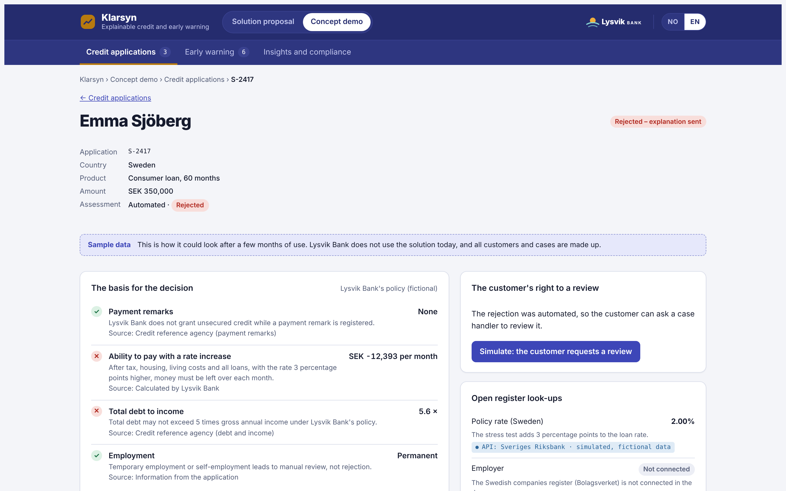

# Klarsyn – forklarbar kreditt og tidlig varsling i Lysvik Bank

En klikkbar konseptdemo av et løsningsforslag: et lag oppå bankens utlånssystemer som forklarer avslag på kredittsøknader, lar kunden be om ny vurdering av et menneske, og fanger opp kunder med betalingsproblemer før saken går til inkasso. Banken trenger ikke bytte kredittmodell. Lysvik Bank, leverandøren Kystlys Software og Klarsyn er fiktive, og alle kunder, søknader og lån er syntetiske.

**Live-demo:** [klarsyn.pages.dev](https://klarsyn.pages.dev) (norsk og engelsk, åpner på engelsk)

## Bakgrunn

- Det nye forbrukerkredittdirektivet (CCD2, direktiv (EU) 2023/2225) gjelder i Sverige, Danmark og Finland fra 20. november 2026. Det stiller krav til forklaring og ny vurdering ved automatiserte avslag, og til tidlig hjelp for kunder i økonomiske vansker.
- I Norge er direktivet ikke tatt inn i EØS-avtalen ennå. I dag gjelder deler av kravene gjennom GDPR artikkel 22 og finansavtaleloven.
- Etter AI Act er systemer som vurderer kredittverdigheten til personer høyrisiko, med krav som gjelder fra 2. desember 2027.

## Hva demoen viser

| Del | Innhold |
|---|---|
| Løsningsforslag | Fire behov, regelverket per land, løsning og integrasjon med åpne API-er, et justerbart business case og veien videre. |
| Kredittsøknader | Kø med søknader i Norge og Sverige. Hver søknad viser grunnlaget for beslutningen, datakildene, forklaringen kunden fikk, «hva som måtte vært annerledes» og reglene som gjelder ved avslag. |
| Ny vurdering | Kunden kan legge til opplysninger og be om ny vurdering. Saksbehandleren ser hva som er endret, og begrunner utfallet. |
| Tidlig varsling | Lån med signaler om betalingsproblemer, med tilbud som lengre løpetid, betalingsutsettelse eller lavere rente, og effekten på månedsbeløpet. |
| Innsikt og etterlevelse | Oversikt over avslag, nye vurderinger og tidlig hjelp, og hvilke krav som gjelder i hvert land. |

## Forklaringen

Kredittvurderingen følger en forenklet, fiktiv policy: betjeningsevne med renteøkning, samlet gjeld mot inntekt og betalingsanmerkninger. Ved avslag kjører demoen modellen på nytt med endrede opplysninger og viser den minste endringen i beløp, løpetid eller gjeld som ville gitt et annet utfall. Det følger EU-domstolens praksis om at kunden skal forstå hvilke prinsipper som ble brukt, ikke selve formelen (C‑203/22 og C‑634/21).

## Teknisk

- Én fil, `index.html`, med HTML, CSS og JavaScript uten rammeverk. Ingen server og ingen innsamling av data.
- Koblingene til de åpne API-ene er simulert: endepunktene er de offentlige, men svarene er fiktive.
- Endringer du gjør i demoen lagres bare i din egen nettleser. Knappen «Tilbakestill demodata» setter alt tilbake.
- Norsk og engelsk, lyst og mørkt tema. Kjør lokalt ved å åpne `index.html` i en nettleser.

## Forbehold

Uavhengig konseptdemo laget av Stein Wulvik. Lysvik Bank, Kystlys Software og Klarsyn er fiktive. Regelverksoversikten er en forenkling og ikke juridisk rådgivning.
